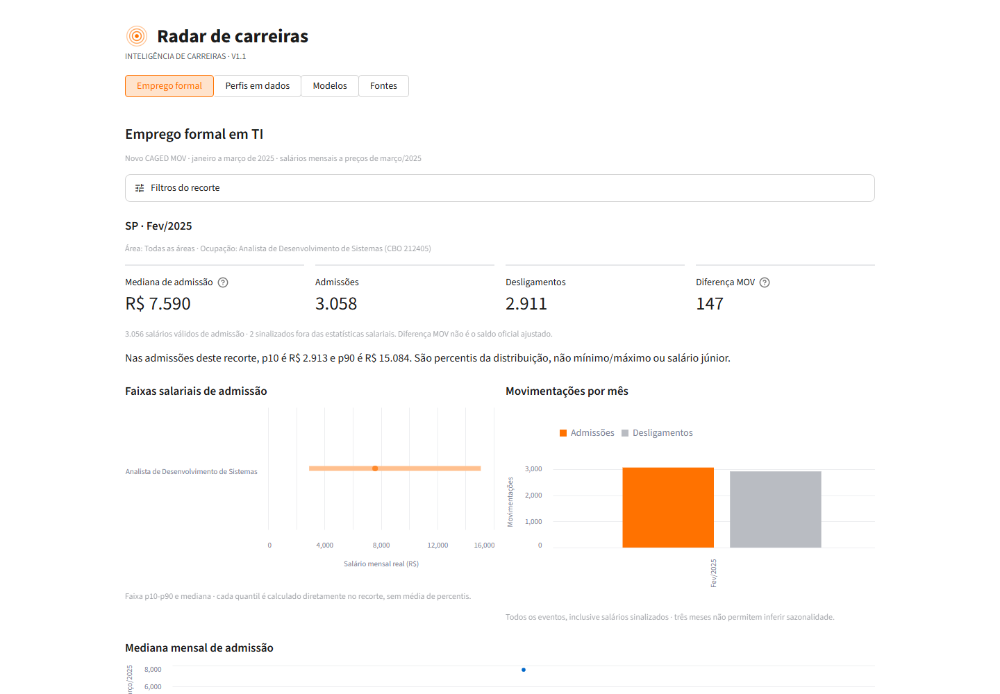
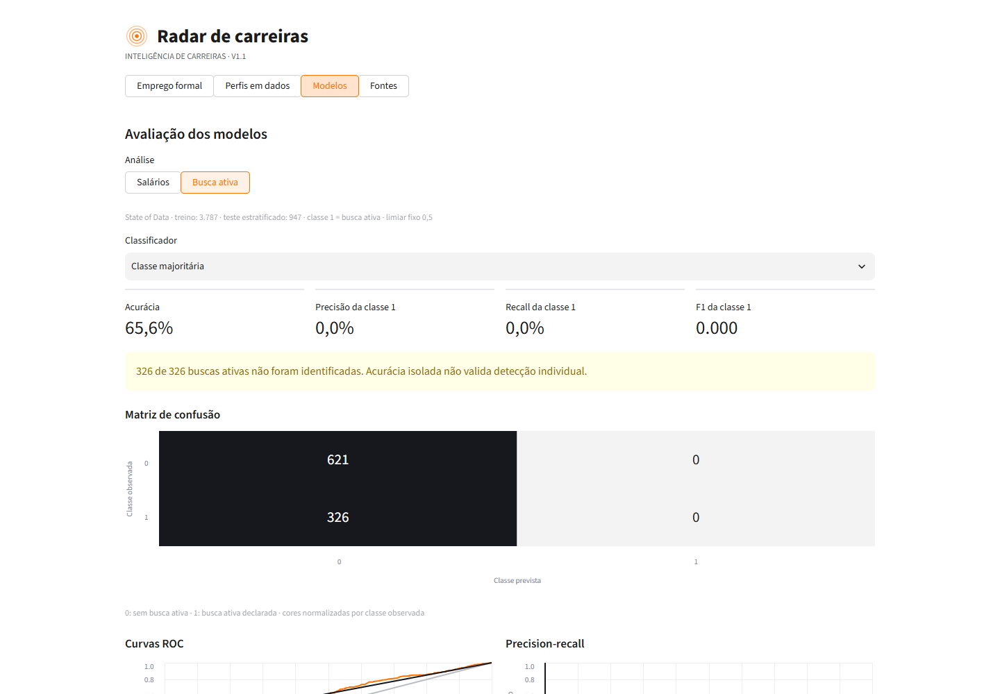
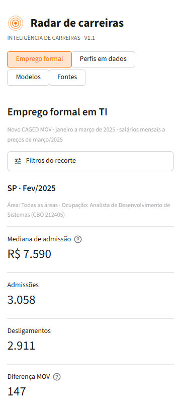
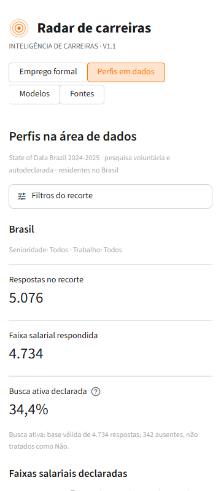

# Radar de Carreiras - Documentação Final

## 1. Visão Executiva

Radar de carreiras | Documentação final da solução analítica e visual | Grupo 12, Projeto 5, CESAR School | Versão 1.1 | 19/10/2026.

O Radar comunica informações sobre emprego formal em ocupações de TI e perfis de carreira em dados, com foco inicial em Pernambuco e Nordeste. A solução combina preparação reproduzível, análise exploratória, modelos simples e um dashboard em Streamlit. As fontes são apresentadas lado a lado, sem inventar uma população única ou acompanhar pessoas entre bases.

| Evidência técnica | Resultado registrado |
| --- | --- |
| Testes da aplicação e dos dados | 111 aprovados na etapa 07 |
| Verificações no navegador | 22 aprovadas em Chromium |
| Conferência de agregados | 65.761 comparações; 0 divergências |
| Recortes conferidos | 4.408 CAGED + 675 State of Data |

Estado da entrega: implementação e documentação técnica organizadas nas oito etapas. O dashboard v1.1 funciona localmente e possui evidências funcionais. A documentação final atende ao escopo de CC10: histórico, decisões, capturas e síntese dos insights. Aprovação acadêmica continua sendo atribuição da professora.

| Etapa | Resultado |
| --- | --- |
| 01 - Plano | Perguntas P1-P12, métricas e justificativas visuais |
| 02 - Preparação | Pipeline, regras de limpeza, categorias e rastreabilidade |
| 03 - Exploração | Distribuições, associações e agrupamentos interpretados |
| 04 - Regressão | Comparação temporal, tendências e resíduos |
| 05 - Classificação | Métricas, matriz de confusão, ROC e precision-recall |
| 06 - Dashboard | Quatro visões e proposta de integração/publicação |
| 07 - Consolidação | Correções, auditoria integral e avaliação funcional local |
| 08 - Documentação | Este relatório, índice das entregas e guia de revisão |

Pendências externas: revisão estruturada pelos colegas, autorização e execução de commit/push, configuração da hospedagem e teste remoto. Não houve teste formal com participantes nem publicação externa. A impressão positiva informal do solicitante não é tratada como validação de usabilidade.

## 2. Dados e Preparação

| Fonte e unidade | Volume e período | Uso e restrição |
| --- | --- | --- |
| Novo CAGED MOV: movimentação formal | 118.564 eventos; jan-mar/2025 | Salários e fluxos das ocupações selecionadas; pacote público agregado |
| State of Data: resposta autodeclarada | 5.076 residentes no Brasil; 2024-2025 | Perfis e busca ativa; amostra voluntária, específica de dados |
| Pesquisa G12: resposta ao questionário | 35 participantes, 12 perguntas; coleta em 2026 | Necessidades e intenções; respostas e saídas individuais restritas ao ambiente local |
| Matriz G12: referência ou hipótese | 21 registros documentais, 10 links | Rastreabilidade da pesquisa; não são participantes nem fatos externamente confirmados |

O recorte CAGED inclui 27 ocupações de sete famílias CBO e dez áreas analíticas. Foram examinadas 13.530.056 linhas brutas para selecionar os 118.564 eventos de TI. As famílias incluem algumas ocupações de automação e não representam todo o setor de tecnologia. PE e Nordeste são subconjuntos do Brasil, não bases adicionais para somar.

- Preservar códigos como texto e tipos anuláveis; priorizar Parquet. CSV de exportação usa UTF-8 com BOM, vírgula e ponto decimal.
- Usar salário mensal real, corrigido pelo IPCA para março/2025. Não multiplicar remuneração já mensal por horas ou dias.
- Manter os 690 salários CAGED sinalizados nas contagens de movimentos, excluindo-os apenas das estatísticas salariais. Entre admissões, 185 ficam fora da análise de salário.
- Preservar eventos CAGED aparentemente iguais: sem identificador de pessoa ou vínculo não há base para remover essas linhas como duplicatas individuais.
- No State of Data, não transformar ausência em Não ou senioridade ausente em Júnior. Remover somente duas duplicatas integrais identificadas na preparação.
- Calcular quantis diretamente nos eventos elegíveis de cada recorte. Exibir estatísticas salariais e comparações somente com base válida de ao menos 30.
- Não converter faixas salariais autodeclaradas em salários exatos; manter a faixa superior aberta. Tecnologias usam denominadores próprios de resposta ao item.
- Manter alertas do G12 sem inventar correções: três respostas fora do domínio em Q07, uma expectativa sinalizada, intervalo de experiência e âncoras de escala a confirmar.

- [Catálogo, unidades e volumes](../datasets/catalogo.md)
- [Plano e justificativas de preparação](../02_preparacao_dados/plano_de_preparacao.md)
- [Registro de fontes e referências ainda não importadas](../datasets/registro_fontes.csv)

## 3. Decisões e Histórico

Fluxo implementado: fontes originais locais, preparação validada, tabelas tratadas por fonte, exploração, modelagem separada, agregados públicos e dashboard. Manifestos e SHA-256 identificam código, insumos e produtos. Os notebooks e relatórios preservam o contexto da etapa em que foram executados; o estado consolidado atual está nesta documentação e na matriz de critérios.

| Momento | Decisão e justificativa |
| --- | --- |
| Plano e integração | Manter CAGED, State of Data e G12 separados. Unidades, períodos e populações são incompatíveis com uma concatenação de pessoas. |
| Preparação | Separar contagem de eventos de validade salarial, preservar ausências e documentar categorias derivadas. Não fabricar respostas nem reconstruir informações ausentes. |
| Exploração | Usar posição, comprimento e eixos comparáveis para contagens e quantis. Agrupamentos são descritivos, não classes naturais de profissionais. |
| Modelagem | Aprender pré-processamento apenas no treino. Selecionar antes do teste e comparar com referência simples; manter erros e resultados limitados visíveis. |
| Dashboard inicial | Criar entrypoint próprio na área de inteligência de carreiras e reutilizar a identidade visual, preservando app/, src/, docs/ e notebooks/ históricos. |
| Consolidação v1.1 | Persistir filtros, explicitar o recorte, corrigir o gráfico por ocupação e restaurar padrões explicitamente. Comparar o CSV realmente baixado com o recorte. |
| Documentação final | Reutilizar evidências verificadas, sem retreinar modelos nem alterar números. Distinguir entrega técnica, feedback de pessoas e hospedagem. |

- Hierarquia: marca discreta, navegação previsível, filtros recolhíveis, indicadores e depois gráficos. Quatro visões: Emprego formal, Perfis em dados, Modelos e Fontes.
- Cores: laranja para destaque, neutros para comparação e alertas textuais. Barras começam em zero; percentis aparecem como faixa e mediana.
- Contexto persistente: fonte, período, geografia, ocupação e bases válidas acompanham o resultado. Recortes vazios ou insuficientes têm mensagens próprias.
- Interatividade: filtros por fonte são independentes; filtros exploratórios não alteram treino/teste ou métricas congeladas dos modelos.

- [Proposta visual e de publicação](../06_dashboard_e_publicacao/proposta_integracao_web.md)
- [Histórico de ajustes e feedback real](../07_consolidacao_e_validacao/feedback_e_ajustes.csv)

## 4. Síntese dos Insights

| Achado observado | Interpretação e limite |
| --- | --- |
| Mediana de admissão: PE R$ 3.165; Brasil R$ 3.520. | Salário mensal a preços de março/2025. Diferenças refletem também composição de cargos; não são salário Júnior ou efeito causal regional. |
| Brasil: 61.047 admissões e 57.517 desligamentos; diferença MOV 3.530. PE: diferença 263. | Contagens incluem salários sinalizados. Sem FOR/EXC, não apresentar a diferença MOV como saldo oficial ajustado. |
| Idade e salário: Spearman 0,510 em 60.862 pares; jornada e salário: -0,054. | Associação descritiva. Idade não equivale a experiência e não mede crescimento individual ou retorno da formação. |
| 67 perfis UF/área agrupados; k=5 teve silhouette 0,410 entre k=2 e 5. | Perfis cobrem 94,8% das admissões salariais válidas, com peso igual por perfil. Não provar cinco grupos naturais ou ranquear pessoas/regiões. |
| 4.734 respostas salariais válidas em 5.076 residentes no Brasil; faixa modal de R$ 8.001 a R$ 12.000/mês. | Resultado da pesquisa voluntária de dados, não de todo TI. Faixa não vira remuneração exata ou média calculada por ponto médio. |
| SQL: 87,7% das 3.502 respostas válidas ao item (3.070 seleções). | Tecnologia declarada não mede vagas ou demanda empresarial. Itens têm bases distintas e múltiplas escolhas podem somar mais de 100%. |
| Busca ativa: 1.630 de 4.734 respostas válidas (34,4%). | As 342 ausências não são negativas. Busca contemporânea declarada não é desligamento futuro ou probabilidade individual de saída. |

Implicação para a solução: priorizar filtros por geografia e ocupação, distribuições em vez de promessa de salário individual, bases válidas visíveis e explicações sobre o que cada fonte mede. Achados da pesquisa própria G12 permanecem em saídas locais restritas; não são publicados neste relatório ou incorporados como se fossem novos eventos CAGED.

- [Síntese pública da exploração](../03_analise_exploratoria/sintese_achados.md)
- [Notebook-fonte da exploração](../03_analise_exploratoria/analise_exploratoria.ipynb)

## 5. Modelagem e Avaliação

Regressão: 60.862 admissões salariais válidas do CAGED. Escolha por MAE na validação janeiro para fevereiro; treino final com 41.037 eventos de jan-fev e teste reservado com 19.825 de março. Referência: mediana do treino. O modelo múltiplo usa idade, horas, CBO, UF e escolaridade, com Ridge alpha=10 fixo.

| Regressor | MAE (R$) | RMSE (R$) | R² |
| --- | --- | --- | --- |
| Mediana do treino | 3.734 | 6.430 | -0,168 |
| Linear: idade | 3.603 | 5.479 | 0,152 |
| Linear: cinco variáveis | 2.667 | 4.307 | 0,476 |

O modelo escolhido antes do teste reduziu MAE em 28,6% frente à referência. Foram mantidas 255 previsões negativas (1,3% do teste), expondo a limitação linear. Melhorar o erro agregado não valida uma calculadora salarial pessoal ou previsão de carreira.

Classificação: State of Data, 4.734 alvos válidos; treino/teste estratificados 80/20, semente 12 (3.787/947). Seleção pela Average Precision média em cinco folds somente do treino; logística escolhida, limiar fixo 0,5. Entradas: senioridade, ensino, vínculo agrupado, trabalho e experiência em dados. Pergunta-alvo e variáveis com texto de busca não entram.

| Classificador | Acurácia | Precisão | Recall | F1 | AUC | AP |
| --- | --- | --- | --- | --- | --- | --- |
| Majoritária | 65,6% | 0,0% | 0,0% | 0,000 | 0,500 | 0,344 |
| Logística | 66,1% | 53,2% | 12,9% | 0,207 | 0,601 | 0,435 |
| Árvore | 64,8% | 39,4% | 4,0% | 0,072 | 0,579 | 0,398 |

Na logística: 42 verdadeiros positivos, 284 falsos negativos, 37 falsos positivos e 584 verdadeiros negativos. O modelo deixa de identificar 87,1% dos positivos. A referência majoritária acerta 65,6%, mas tem recall zero. Portanto, acurácia isolada seria enganosa; não usar os modelos para rotular empregados ou orientar contratação/desligamento.

Nenhum teste foi reutilizado para escolher modelo, hiperparâmetros ou limiar. AP não é área trapezoidal genérica da curva PR. São avaliações observacionais: um mês reservado na regressão e uma mesma coleta na classificação, sem validação temporal externa desta última.

- [Regressão: notebook executado e gráficos](../04_regressao/resultados/regressao_salarial.html)
- [Classificação: notebook executado e gráficos](../05_classificacao/resultados/classificacao_busca_ativa.html)

## 6. Evidência: Emprego Formal

Captura real da versão 1.1, em desktop 1440x1000. Recorte: SP, fevereiro/2025, CBO 212405 (Analista de Desenvolvimento de Sistemas). O gráfico de faixa salarial acompanha a ocupação, mesmo com Todas as áreas selecionado.



Indicadores, faixa p10-p90 com mediana e volumes mensais. Captura do viewport, não de todo o conteúdo rolável.

- Os números deste recorte são 3.058 admissões, 2.911 desligamentos e diferença MOV 147; a mediana real de admissão é aproximadamente R$ 7.590.
- A identificação do cargo/CBO permanece visível com o painel fechado. P10/p90 não são mínimo/máximo nem remuneração inicial Júnior.
- A consolidação corrigiu um aviso falso de base insuficiente no gráfico de ocupação. O download é comparado ao conteúdo agregado efetivamente filtrado.
- Filtros ficam na sessão ao trocar de visão. Restaurar filtros usa padrões explícitos e não altera os filtros da outra fonte.

- [Captura original em resolução integral](../07_consolidacao_e_validacao/evidencias/01_recorte_consolidado_desktop.png)
- [Aplicativo implementado](../06_dashboard_e_publicacao/dashboard.py)

## 7. Evidência: Modelos

A captura mostra a referência majoritária, não a logística selecionada no treino. Manter a referência visível permite discutir por que acurácia sem recall não valida detecção de busca ativa.



Referência majoritária: 621 negativos corretos, 326 falsos negativos e nenhum positivo identificado. A matriz preserva as contagens; a cor é normalizada por classe observada.

- O seletor compara resultados já calculados, sem retreinar ou escolher pelo teste. Os filtros exploratórios não redefinem a população de avaliação dos modelos.
- A logística é apresentada com recall de 12,9%, e não como solução pronta para decisão individual. Os erros e limites acompanham a comunicação dos resultados.
- ROC e precision-recall estão no aplicativo e no notebook executado. A curva PR usa degraus, evitando representar a referência constante como uma diagonal interpolada enganosa.

- [Captura original em resolução integral](../07_consolidacao_e_validacao/evidencias/02_modelo_referencia_desktop.png)
- [Métricas agregadas de classificação](../05_classificacao/resultados/tabelas/C1_metricas_teste.csv)

## 8. Validação e Telas Menores

Execução técnica da etapa 07: 111 testes aprovados; 22 verificações no Chromium; 65.761 comparações numéricas sem divergências em 5.083 recortes. A etapa 08 confere integridade e documentação, sem declarar novos testes de aplicação ou retreinamento.





Capturas em 360x800. A bateria ampliada verifica as quatro visões em 360x800, 768x1024 e 1440x1000, incluindo gráficos não vazios e ausência de overflow horizontal. A bateria inicial também cobre 390x844. O QA aguarda a execução real do Streamlit e a atualização visual antes de conferir o recorte.

Composição da execução: preparação 17; exploração 11; regressão 17; classificação 24; dashboard inicial 23; consolidação 19. Os resultados por suite e as versões de ambiente estão nos registros de execução da etapa 06 e da etapa 07.

Verificações cobrem filtros dependentes, persistência, restauração, sessões separadas, estados vazios/insuficientes, CSV realmente baixado, integridade do pacote e seleção básica por teclado. Isso não é certificação de acessibilidade, teste com leitor de tela ou validação em todos os navegadores.

- [Registro da execução e hashes](../07_consolidacao_e_validacao/registro_execucao.json)
- [Auditoria numérica integral](../07_consolidacao_e_validacao/resultados/auditoria_numerica.json)

## 9. Limites e Melhorias

- Cobertura: CAGED mede emprego formal no recorte de ocupações, não PJ, informalidade ou todo TI. MOV não inclui os ajustes FOR/EXC.
- Tempo: salários a preços de março/2025 e pesquisa 2024-2025 não descrevem remuneração atual de 2026. Três meses não demonstram sazonalidade ou tendência anual.
- Unidade: eventos não são pessoas ou vínculos acompanhados; não inferir promoção, evolução individual ou causalidade por comparar grupos.
- Pesquisa: amostra voluntária e ramificações geram viés de seleção/elegibilidade. Três residentes no Brasil têm UF ausente e não são atribuídos a um estado fictício.
- Modelos: previsões negativas e baixo recall permanecem. Não há validação externa, auditoria de equidade ou autorização para uso em decisões laborais individuais.
- Privacidade: respostas G12, IDs, previsões e escores individuais não entram no pacote público. A regra de n mínimo não prova anonimização universal ou representatividade.
- Referências: RAIS, PNAD, INEP, Base dos Dados, Brasscom e Exame são contexto ou possíveis ampliações, não microdados adicionais já importados neste pacote.

| Prioridade | Melhoria e critério de conclusão |
| --- | --- |
| Antes da revisão final | Executar o roteiro com colegas; registrar observações reais, decisão, correção e reteste. Ainda não realizado. |
| Antes da divulgação | Revisar arquivos versionáveis e autorização de envio; depois configurar Streamlit e validar a URL remota. |
| Próximo ciclo | Avaliar leitor de tela, contraste sistemático e outros navegadores; não afirmar conformidade sem essas verificações. |
| Ampliação de dados | Adicionar competências/ajustes e novas fontes apenas com cobertura, unidade e procedência documentadas. |
| Evolução analítica | Validar em outro período/coleta e definir custos de erro antes de mudar limiares ou recomendar uso dos modelos. |

Histórico de feedback: o solicitante viu a prévia e achou boa; isso é uma impressão informal real. A revisão estruturada pelos amigos ainda será feita. Melhorias de navegação, gráficos, download e restauração vieram da revisão técnica/visual, não de um estudo com usuários inventado.

- [Roteiro para revisão real](../07_consolidacao_e_validacao/roteiro_revisao.md)
- [Registro de feedback e ajustes](../07_consolidacao_e_validacao/feedback_e_ajustes.csv)

## 10. Reprodução e Entrega

Para abrir o dashboard, basta o repositório com o pacote público agregado; os arquivos brutos, as respostas G12 e os datasets tratados locais não são necessários. Recomendação de ambiente reproduzível: Python 3.12, ambiente virtual e versões fixadas nos requirements.

```powershell
# Na raiz do repositorio, com o ambiente Python ativo
cd inteligencia_de_carreiras/06_dashboard_e_publicacao
python -m pip install -r requirements.txt
python -m streamlit run dashboard.py --global.developmentMode false --server.port 8502
```

Usar outra porta se 8502 estiver ocupada. O endereço local 127.0.0.1 só funciona na máquina que executa o servidor. O envio deste endereço aos colegas não publica o aplicativo. A proposta de hospedagem Streamlit está pronta, mas a implantação externa ainda não foi realizada.

Para reconstruir análises e executar a validação completa, seguir os READMEs das etapas 02-07 com os insumos locais necessários. Não publicar os dados privados para facilitar a reprodução. Para regenerar esta documentação, executar gerar_documentacao.py e validar_documentacao.py nesta pasta; a validação visual do PDF continua sendo uma etapa explícita.

- [Guia de entrega, evidências CC01-CC10 e checklist](guia_entrega.md)
- [Rubrica original da disciplina](../00_referencias/criterios_avd_cc.pdf)
- [Matriz atualizada de critérios](../00_referencias/matriz_criterios.csv)
- [Plano de análise e decisões visuais](../01_plano_de_analise/plano_de_analise.md)
- [Preparação e reprodução dos dados](../datasets/LEIA-ME.md)
- [Manifesto do pacote público](../06_dashboard_e_publicacao/dados_publicos/manifesto.json)
- [Proposta de integração e hospedagem](../06_dashboard_e_publicacao/proposta_integracao_web.md)
- [Repositório de origem](https://github.com/Leonardo-Mello22/Radar-de-Carreiras)
- [MTE: origem dos microdados](https://www.gov.br/trabalho-e-emprego/pt-br/assuntos/estatisticas-trabalho/microdados-rais-e-caged)
- [State of Data: origem da pesquisa pública](https://www.kaggle.com/datasets/datahackers/state-of-data-brazil-20242025)

Caminhos de evidência são relativos a esta pasta; o Markdown é o índice navegável no repositório. URLs de origem são referências registradas, não afirmação de checagem online nesta etapa. Este documento não foi submetido à disciplina, enviado aos colegas, publicado, commitado ou enviado ao GitHub automaticamente.
